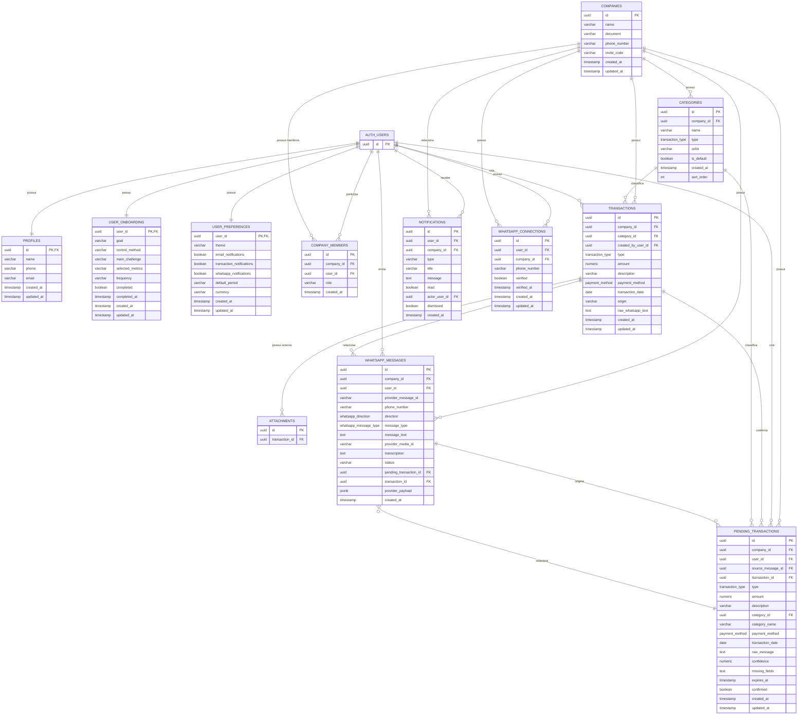

# 🗄️ Modelagem do Banco de Dados

O banco de dados do **MetricsFlow AI** utiliza **PostgreSQL através do Supabase**.

A modelagem é organizada em torno das principais entidades do sistema, incluindo usuários, perfis, empresas, membros, categorias, transações, notificações, anexos e recursos relacionados à integração com WhatsApp.

A autenticação dos usuários é realizada pelo **Supabase Auth**, cuja tabela `auth.users` é utilizada como referência para os dados relacionados aos usuários da aplicação.

## Diagrama Entidade-Relacionamento



> **Nota:** o diagrama representa a estrutura lógica documentada. Os campos de `attachments` devem ser complementados conforme o schema real do banco de dados.

## Principais entidades

### `auth.users`

Tabela gerenciada pelo Supabase Auth, responsável pelo armazenamento dos usuários autenticados da plataforma.

A chave `id` identifica o usuário no sistema e é utilizada como referência nas demais tabelas relacionadas à autenticação.

---

### `profiles`

Armazena os dados complementares do usuário.

Principais informações:

- Nome;
- E-mail;
- Telefone;
- Data de criação;
- Data de atualização.

A chave primária `id` também funciona como chave estrangeira para `auth.users`.

---

### `user_onboarding`

Armazena as informações coletadas durante o processo inicial de configuração do usuário.

Entre os dados registrados estão:

- Objetivo;
- Método de controle financeiro;
- Principal desafio;
- Métricas selecionadas;
- Frequência;
- Status de conclusão.

A entidade é vinculada diretamente ao usuário autenticado.

---

### `user_preferences`

Armazena as preferências individuais do usuário, incluindo:

- Tema;
- Notificações por e-mail;
- Notificações de movimentações;
- Notificações do WhatsApp;
- Período financeiro padrão;
- Moeda.

Essas informações permitem personalizar o comportamento da aplicação para cada usuário.

---

### `companies`

Representa as empresas cadastradas na MetricsFlow AI.

Principais informações:

- Nome;
- Documento;
- Telefone;
- Código de convite;
- Data de criação;
- Data de atualização.

Uma empresa pode possuir diversos membros, categorias, transações, notificações e dados relacionados ao WhatsApp.

---

### `company_members`

É a entidade responsável pelo relacionamento entre usuários e empresas.

Ela permite que diferentes usuários participem de uma mesma empresa e define o papel de cada membro.

Os principais papéis utilizados pelo sistema são:

- `owner`;
- `collaborator`.

Esse relacionamento também é utilizado no controle de permissões da aplicação.

---

### `categories`

Representa as categorias financeiras utilizadas para classificar as movimentações.

Cada categoria pertence a uma empresa e possui um tipo:

- Receita;
- Despesa.

Também são armazenadas informações como nome, cor, identificação de categoria padrão e ordem de exibição.

---

### `transactions`

Representa as movimentações financeiras registradas no sistema.

Cada movimentação possui informações como:

- Empresa;
- Categoria;
- Usuário responsável pelo registro;
- Tipo;
- Valor;
- Descrição;
- Forma de pagamento;
- Data da movimentação;
- Origem;
- Texto original do WhatsApp, quando aplicável.

A origem permite identificar se a movimentação foi criada pela aplicação web ou por outra origem prevista na implementação.

---

### `attachments`

Representa os anexos associados às movimentações financeiras da MetricsFlow AI.

A entidade mantém o relacionamento entre os arquivos e as respectivas transações, permitindo consultar os anexos de uma movimentação específica.

Os anexos são disponibilizados pelo backend através do endpoint:

`GET /api/transactions/:id/attachments`

Esse endpoint utiliza o identificador da transação para consultar os anexos relacionados, respeitando as regras de autenticação e autorização implementadas no backend.

Os metadados armazenados nessa tabela devem ser documentados de acordo com as colunas efetivamente existentes no banco.

**Observação:** os arquivos podem ser armazenados no Supabase Storage, enquanto a tabela `attachments` mantém as referências e os metadados relacionados. A configuração do bucket é descrita na documentação de arquitetura.

---

### `notifications`

Armazena as notificações apresentadas aos usuários.

Uma notificação pode estar relacionada a uma empresa, a um usuário, a uma movimentação ou a uma ação realizada por outro usuário.

A coluna `actor_user_id` permite identificar o usuário responsável pela ação que originou a notificação.

A coluna `read` controla se a notificação já foi visualizada, enquanto `dismissed` permite registrar se ela foi dispensada.

---

### `whatsapp_connections`

Representa os dados de conexão de um usuário e de uma empresa relacionados ao WhatsApp.

A entidade armazena informações como usuário, empresa, número de telefone, status de verificação e datas de criação e atualização.

A existência dessa tabela não significa que a integração oficial com a Meta esteja ativa em produção.

---

### `whatsapp_messages`

Armazena as mensagens relacionadas ao processamento da integração com WhatsApp.

Entre os dados representados estão:

- Identificador da mensagem no provedor;
- Número de telefone;
- Direção da mensagem;
- Tipo da mensagem;
- Texto;
- Identificador de mídia;
- Transcrição;
- Status;
- Transação relacionada;
- Transação pendente relacionada;
- Payload recebido do provedor;
- Data de criação.

O campo `provider_message_id` permite identificar a mensagem no provedor e pode auxiliar no controle de mensagens duplicadas.

---

### `pending_transactions`

Representa uma movimentação financeira interpretada pelo sistema, mas ainda sujeita à confirmação do usuário.

Essa entidade está relacionada ao fluxo de processamento de mensagens financeiras, especialmente no contexto do WhatsApp.

O processo lógico é:

```text
Mensagem do usuário
        ↓
Interpretação da mensagem
        ↓
Extração dos dados financeiros
        ↓
Criação da transação pendente
        ↓
Solicitação de confirmação
        ↓
Confirmação do usuário
        ↓
Registro da transação
```

A transação pendente representa os dados provisórios extraídos da mensagem. A efetivação da movimentação depende das validações e do fluxo de confirmação implementados no backend.

## Principais relacionamentos

### Usuários e perfis

```text
auth.users
     │
     │ 1 : 1
     ▼
profiles
```

Cada usuário autenticado possui um perfil complementar.

### Usuários e empresas

```text
auth.users
     │
     │ 1 : N
     ▼
company_members
     │
     │ N : 1
     ▼
companies
```

Um usuário pode participar de uma ou mais empresas, enquanto uma empresa pode possuir vários membros.

A tabela `company_members` funciona como entidade de associação entre usuários e empresas.

### Empresas e categorias

```text
companies
     │
     │ 1 : N
     ▼
categories
```

Uma empresa pode possuir diversas categorias financeiras.

### Empresas e transações

```text
companies
     │
     │ 1 : N
     ▼
transactions
```

Cada movimentação financeira pertence a uma empresa.

### Categorias e transações

```text
categories
     │
     │ 1 : N
     ▼
transactions
```

Uma categoria pode ser utilizada por várias movimentações. A obrigatoriedade de uma categoria em cada transação depende das constraints e regras efetivamente implementadas.

### Usuários e transações

```text
auth.users
     │
     │ 1 : N
     ▼
transactions
```

O campo `created_by_user_id` identifica o usuário responsável pelo registro da movimentação.

### Transações e anexos

```text
transactions
     │
     │ 1 : N
     ▼
attachments
```

Uma transação pode possuir vários anexos associados. O relacionamento permite consultar os arquivos vinculados a uma movimentação financeira específica.

### Empresas e notificações

```text
companies
     │
     │ 1 : N
     ▼
notifications
```

Uma empresa pode possuir diversas notificações relacionadas às suas atividades.

### Usuários e notificações

```text
auth.users
     │
     │ 1 : N
     ▼
notifications
```

Um usuário pode receber diversas notificações. A relação `actor_user_id` permite identificar o usuário responsável pela ação que originou uma notificação.

### Empresas e integração com WhatsApp

```text
companies
     │
     ├──────────────► whatsapp_connections
     │
     └──────────────► whatsapp_messages
```

As entidades representam os dados relacionados às conexões e às mensagens associadas às empresas.

### WhatsApp e transações pendentes

```text
whatsapp_messages
        │
        │ relacionamento por mensagem de origem
        ▼
pending_transactions
```

Uma mensagem pode originar informações utilizadas no processamento de uma transação pendente, conforme as regras de negócio implementadas.

### Transações pendentes e transações definitivas

```text
pending_transactions
        │
        │ confirmação
        ▼
transactions
```

A transação pendente representa o resultado provisório da interpretação. Após a confirmação e as validações necessárias, os dados podem resultar em uma transação financeira definitiva.

## Organização lógica do modelo

De forma simplificada, o modelo pode ser dividido em quatro grupos.

### Autenticação e personalização

```text
auth.users
    │
    ├── profiles
    ├── user_onboarding
    └── user_preferences
```

### Organização empresarial

```text
companies
    │
    └── company_members
```

### Gestão financeira

```text
companies
    ├── categories
    └── transactions
            │
            └── attachments
```

### WhatsApp e processamento por IA

```text
whatsapp_connections

whatsapp_messages
        │
        ▼
pending_transactions
        │
        ▼
transactions
```

## 🔐 Segurança e integridade

A modelagem do banco trabalha em conjunto com as políticas de segurança do Supabase e com as regras de negócio implementadas no backend.

Os mecanismos de segurança e integridade podem incluir:

- Autenticação através do Supabase Auth;
- Relacionamento entre usuários e empresas;
- Controle de papéis através de `company_members`;
- Chaves primárias e estrangeiras;
- Constraints;
- Row Level Security (RLS);
- Validação das operações no backend;
- Funções e triggers do banco;
- Controle de acesso por empresa.

O **Row Level Security (RLS)** permite restringir o acesso aos registros de acordo com as políticas configuradas no banco.

Para anexos, o acesso deve considerar tanto a autorização para consultar a transação associada quanto as políticas aplicáveis ao arquivo armazenado no Supabase Storage.

A configuração efetiva dessas políticas deve ser verificada no banco e no Storage, evitando assumir que a autorização do endpoint, isoladamente, protege o acesso direto aos arquivos.

## ⚙️ Persistência e recuperação dos dados

O PostgreSQL é utilizado pela aplicação para operações de criação, consulta, atualização, exclusão, filtragem e relacionamento entre entidades.

As movimentações financeiras são persistidas na tabela `transactions` e utilizadas nas áreas da aplicação que consomem esses dados, como:

- Dashboard;
- Movimentações;
- DRE;
- Notificações;
- Funcionalidades relacionadas ao WhatsApp.

Os anexos são associados às movimentações por meio da tabela `attachments`. Quando os arquivos são armazenados no Supabase Storage, o banco mantém as referências necessárias para relacioná-los aos registros financeiros.

As informações de usuários, empresas, categorias e preferências também são persistidas e utilizadas conforme o contexto do usuário autenticado.

## 📌 Coerência entre modelagem e implementação

Este documento descreve a estrutura lógica do banco de dados da MetricsFlow AI. Para manter a documentação sincronizada com a implementação, os nomes, tipos, constraints e relacionamentos devem corresponder ao schema efetivamente configurado no PostgreSQL.

O fluxo financeiro principal pode ser representado da seguinte forma:

```text
Usuário
   ↓
Empresa
   ↓
Categorias
   ↓
Transações
   ├── Anexos
   ↓
Dashboard / DRE
```

O fluxo de processamento de mensagens financeiras relacionadas ao WhatsApp pode ser representado assim:

```text
Mensagem
   ↓
Interpretação
   ↓
pending_transactions
   ↓
Validação e confirmação
   ↓
transactions
   ↓
Dashboard / DRE
```

A tabela `attachments` complementa o modelo financeiro ao associar arquivos às transações. A configuração do armazenamento físico, incluindo o bucket do Supabase Storage, deve ser detalhada separadamente na documentação de arquitetura.
