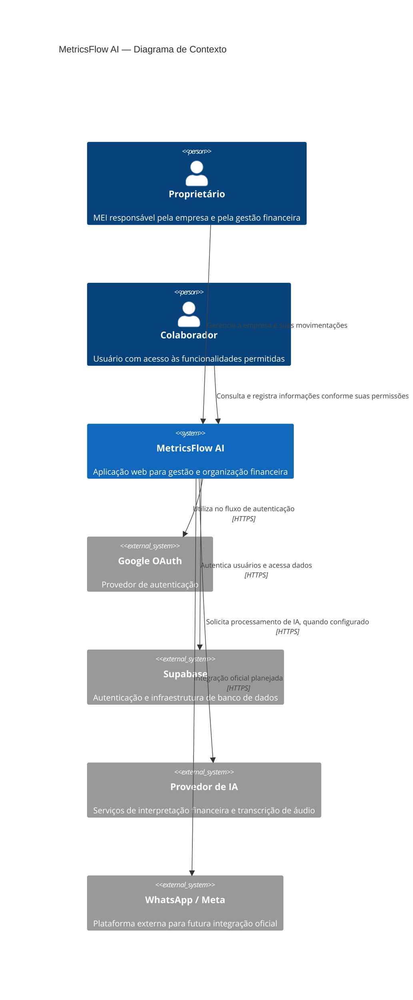
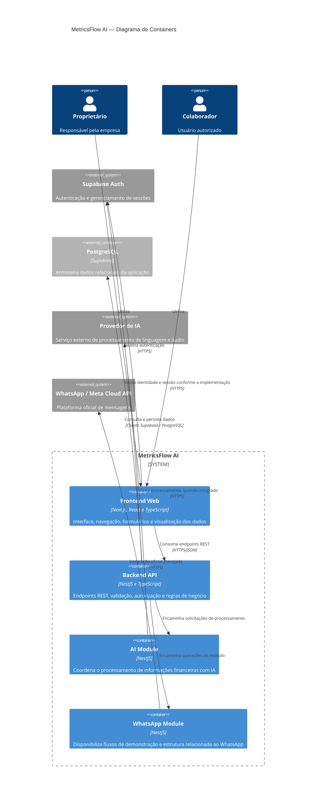
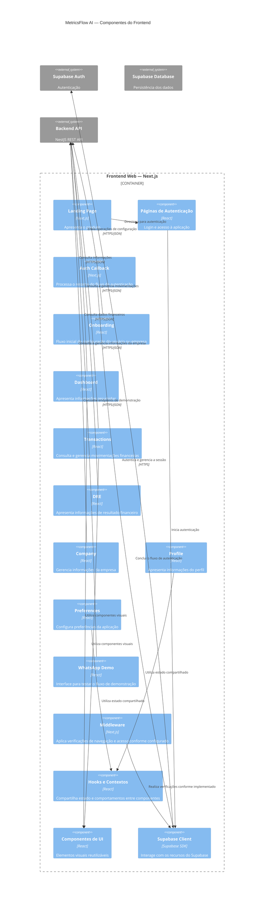
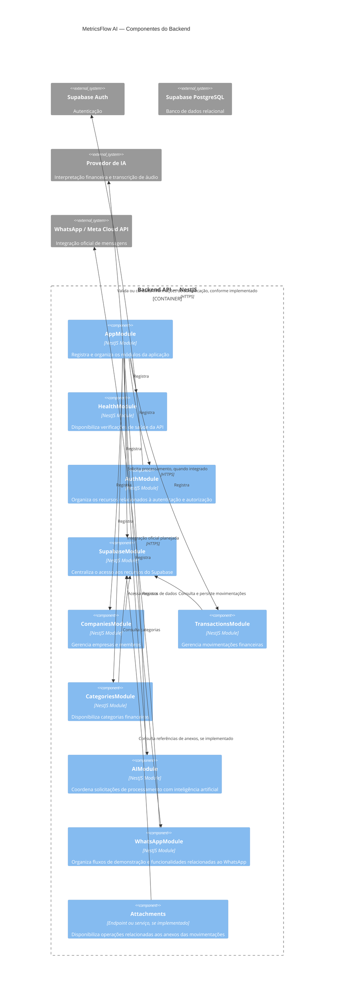
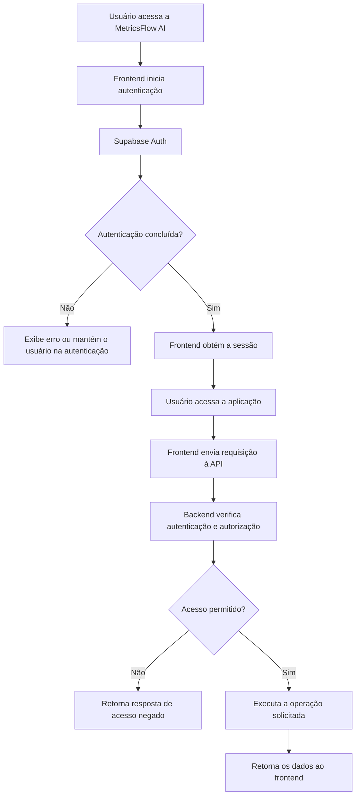
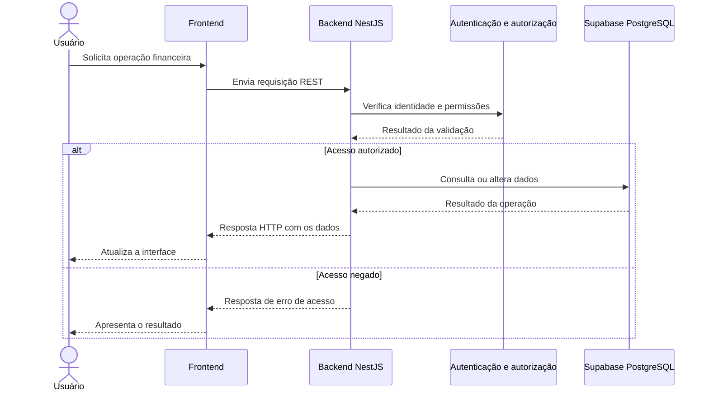
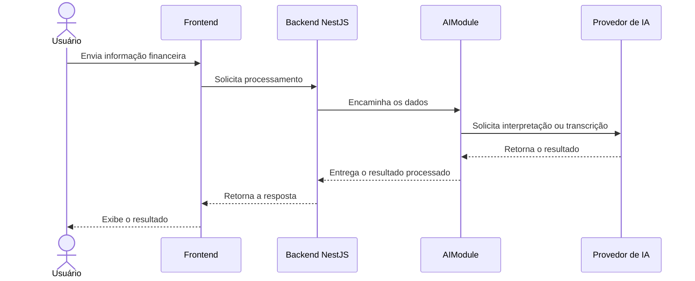
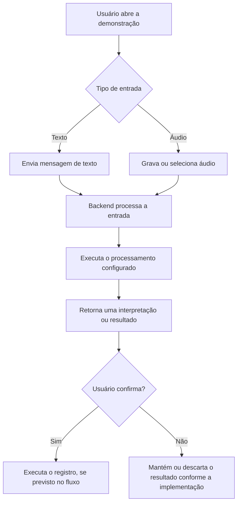
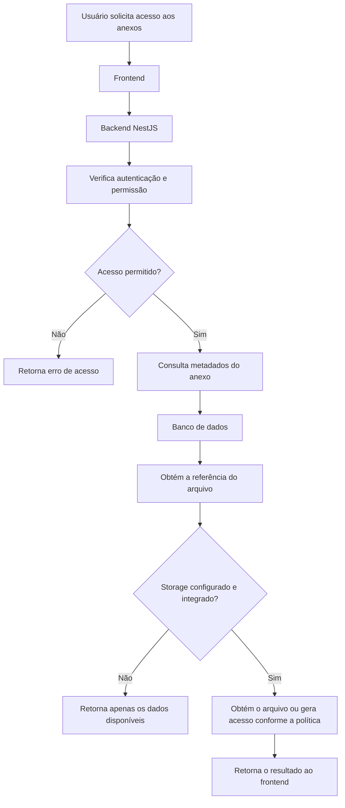
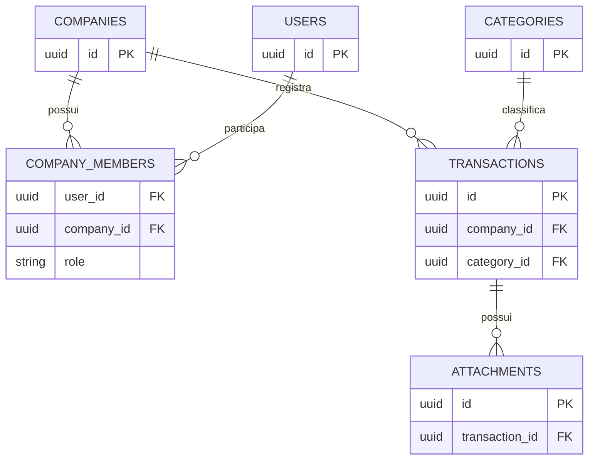

# Arquitetura da MetricsFlow AI

## 1. Visão geral

A **MetricsFlow AI** é uma aplicação de gestão financeira que permite organizar empresas, categorias e movimentações financeiras, com recursos de inteligência artificial para auxiliar no processamento de informações financeiras.

A arquitetura é dividida em:

- **Frontend:** aplicação web desenvolvida com Next.js, React e TypeScript.
- **Backend:** API REST desenvolvida com NestJS e TypeScript.
- **Autenticação:** Supabase Auth, incluindo suporte ao login com Google.
- **Banco de dados:** PostgreSQL disponibilizado pelo Supabase.
- **Inteligência artificial:** módulo responsável por coordenar o processamento de informações financeiras.
- **WhatsApp:** módulo com funcionalidades de demonstração e estrutura preparada para integração com a API oficial.
- **Armazenamento de arquivos:** camada relacionada aos anexos das movimentações, cuja configuração e integração devem corresponder à implementação efetiva do projeto.

## 2. Diagrama de contexto — C4 Level 1

O diagrama de contexto apresenta os principais usuários, o sistema e os serviços externos com os quais ele pode interagir.

### 2.1. Elementos do contexto

| Elemento        | Responsabilidade                                                                    |
| --------------- | ----------------------------------------------------------------------------------- |
| Proprietário    | Responsável pela empresa e pela gestão das informações financeiras.                 |
| Colaborador     | Acessa as funcionalidades autorizadas para sua participação na empresa.             |
| MetricsFlow AI  | Centraliza a interface e as operações da aplicação.                                 |
| Google OAuth    | Participa do processo de autenticação quando habilitado.                            |
| Supabase        | Fornece autenticação e infraestrutura de dados.                                     |
| Provedor de IA  | Pode processar informações financeiras e áudio, conforme a integração implementada. |
| WhatsApp / Meta | Representa a integração oficial prevista para o projeto.                            |

## 3. Diagrama de containers — C4 Level 2

O diagrama apresenta as principais aplicações e os serviços que compõem a solução.

### 3.1. Responsabilidade dos containers

| Container       | Responsabilidade                                                                       |
| --------------- | -------------------------------------------------------------------------------------- |
| Frontend Web    | Apresenta as páginas, recebe entradas dos usuários e exibe as informações financeiras. |
| Backend API     | Centraliza os endpoints, aplica regras de negócio e controla o acesso aos recursos.    |
| AI Module       | Organiza as operações relacionadas à inteligência artificial.                          |
| WhatsApp Module | Agrupa as funcionalidades relacionadas ao WhatsApp, incluindo o fluxo de demonstração. |
| Supabase Auth   | Gerencia a autenticação e as sessões dos usuários.                                     |
| PostgreSQL      | Armazena as entidades e os relacionamentos persistentes.                               |
| Provedor de IA  | Processa solicitações encaminhadas pelo backend, quando a integração está ativa.       |
| WhatsApp / Meta | Serviço externo previsto para a integração oficial de mensagens.                       |

## 4. Diagrama de componentes do Frontend — C4 Level 3

O frontend organiza a interface em páginas, componentes reutilizáveis, gerenciamento de sessão e comunicação com os serviços externos.

### 4.1. Responsabilidades dos componentes

- **Landing Page:** apresenta a aplicação e suas funcionalidades.
- **Páginas de autenticação:** permitem iniciar o fluxo de login.
- **Auth Callback:** trata o retorno da autenticação.
- **Onboarding:** conduz o usuário pela configuração inicial, conforme o fluxo implementado.
- **Dashboard:** reúne informações financeiras resumidas.
- **Transactions:** apresenta as movimentações e suas operações disponíveis.
- **DRE:** apresenta informações de resultado financeiro.
- **Company:** concentra as funcionalidades relacionadas à empresa.
- **Profile:** apresenta informações do usuário.
- **Preferences:** reúne as preferências da aplicação.
- **WhatsApp Demo:** permite testar o fluxo de demonstração sem pressupor uma integração oficial ativa.
- **Middleware:** executa verificações de navegação e acesso configuradas no Next.js.
- **Hooks e Contextos:** compartilham estado e lógica entre componentes.
- **Componentes de UI:** padronizam elementos visuais reutilizáveis.
- **Supabase Client:** fornece acesso aos recursos do Supabase usados pelo frontend.

## 5. Diagrama de componentes do Backend — C4 Level 3

O backend utiliza NestJS para organizar endpoints, autenticação, regras de negócio, acesso a dados e funcionalidades auxiliares.

### 5.1. Responsabilidades dos módulos

| Módulo             | Responsabilidade                                                                               |
| ------------------ | ---------------------------------------------------------------------------------------------- |
| AppModule          | Registra os módulos da aplicação.                                                              |
| HealthModule       | Disponibiliza uma rota para verificar a saúde da API.                                          |
| AuthModule         | Organiza recursos de autenticação e autorização.                                               |
| SupabaseModule     | Centraliza o acesso ao Supabase.                                                               |
| CompaniesModule    | Gerencia empresas e membros.                                                                   |
| TransactionsModule | Gerencia movimentações financeiras.                                                            |
| CategoriesModule   | Disponibiliza categorias financeiras.                                                          |
| AIModule           | Coordena as operações relacionadas à IA.                                                       |
| WhatsAppModule     | Agrupa os fluxos de demonstração e as funcionalidades relacionadas ao WhatsApp.                |
| Attachments        | Representa as operações de anexos somente se houver um endpoint ou serviço dedicado no código. |

**Importante:** o endpoint `GET /api/transactions/:id/attachments`, caso esteja implementado, pode fazer parte do `TransactionsModule`. Não é necessário criar um módulo `Attachments` separado apenas porque existe uma rota de anexos.

## 6. Fluxo de autenticação e acesso

O Supabase Auth gerencia a identidade e a sessão do usuário. A aplicação associa os usuários às empresas por meio dos registros de participação, respeitando os papéis e as permissões implementados.

O fluxo acima é uma representação conceitual. As verificações exatas dependem dos guards, da validação de tokens, das políticas de acesso e das regras de negócio implementadas.

## 7. Fluxo de movimentações financeiras

O fluxo geral de movimentações envolve o frontend, a API, as regras de autorização e a persistência dos dados.

## 8. Fluxo de inteligência artificial

O módulo de IA deve coordenar as solicitações feitas pelo backend a um provedor externo. O provedor e os modelos utilizados precisam corresponder às configurações reais do projeto.

### 8.1. Configuração do provedor

Caso a integração com a Groq esteja implementada, o diagrama pode identificar explicitamente o provedor:

- **Provedor:** Groq API.
- **Credencial:** chave de API armazenada em variável de ambiente.
- **Modelo financeiro:** definido pela configuração utilizada no serviço.
- **Modelo de transcrição:** definido pela configuração utilizada no serviço.

As variáveis de ambiente devem corresponder ao código que lê essas configurações. Alterar o nome de uma variável não altera automaticamente o provedor usado pela aplicação.

## 9. Fluxo de demonstração do WhatsApp

O módulo possui um fluxo de demonstração para testar o processamento de mensagens. Esse fluxo deve ser documentado separadamente da integração oficial com a Meta.

> Esse fluxo representa a demonstração. Não implica que o webhook oficial, a conexão com a WhatsApp Cloud API ou o recebimento de mensagens reais estejam ativos em produção.

## 10. Arquitetura de anexos das movimentações

Os anexos podem envolver duas responsabilidades distintas:

1. **Banco de dados:** armazena os metadados e a referência do arquivo.
2. **Armazenamento de objetos:** guarda o conteúdo binário do arquivo, caso exista um serviço de storage configurado.

O diagrama abaixo representa essa separação de responsabilidades. O serviço de armazenamento e os relacionamentos só devem ser considerados implementados depois de confirmar a configuração e o código.

### 10.1. Considerações sobre anexos

- A existência de uma tabela `attachments` não comprova, por si só, que o upload e o download de arquivos estejam implementados.
- O nome do bucket, as políticas de acesso, os tipos de arquivo aceitos e os limites de tamanho devem ser documentados a partir da configuração real.
- O acesso aos anexos deve respeitar as permissões da empresa e da movimentação associada.
- Se o conteúdo for armazenado em Supabase Storage, documente o bucket e suas políticas separadamente do esquema relacional.

## 11. Estrutura lógica do banco de dados

O banco de dados utiliza PostgreSQL no Supabase. Entre as entidades relacionadas à aplicação estão usuários, empresas, membros, categorias e movimentações financeiras.

O diagrama abaixo é uma visão simplificada. Ele não substitui o esquema real do banco, e as cardinalidades e os nomes das chaves devem ser conferidos com as migrations ou definições atuais.

> **Atenção:** esse ERD é conceitual e inclui apenas campos mínimos para representar as relações. Antes de tratá-lo como documentação definitiva, confira os nomes reais das tabelas, as chaves estrangeiras, os campos obrigatórios e a existência da tabela `users`. Se o identificador do usuário for gerenciado diretamente pelo Supabase Auth, o relacionamento pode apontar para a tabela de usuários do schema `auth`, em vez de uma tabela pública chamada `users`.

## 12. Princípios arquiteturais

- **Separação de responsabilidades:** interface, API, persistência e integrações externas possuem responsabilidades distintas.
- **Organização modular:** o backend utiliza módulos NestJS para agrupar funcionalidades.
- **Autorização por contexto empresarial:** as operações devem considerar a empresa e as permissões do usuário.
- **Integrações desacopladas:** provedores externos devem ser acessados por serviços específicos.
- **Segurança:** credenciais e chaves privadas devem permanecer no backend ou em configurações seguras.
- **Documentação fiel à implementação:** diagramas, endpoints e integrações devem ser atualizados quando o código mudar.
