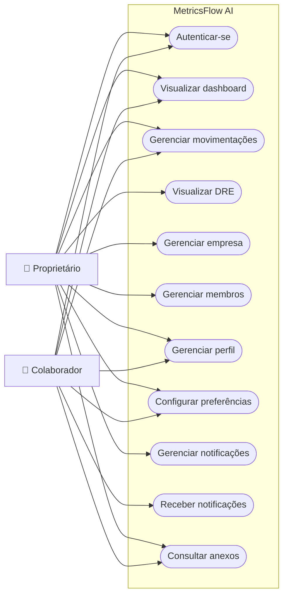
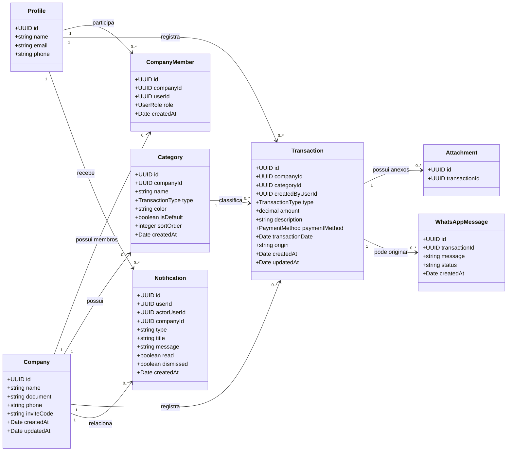
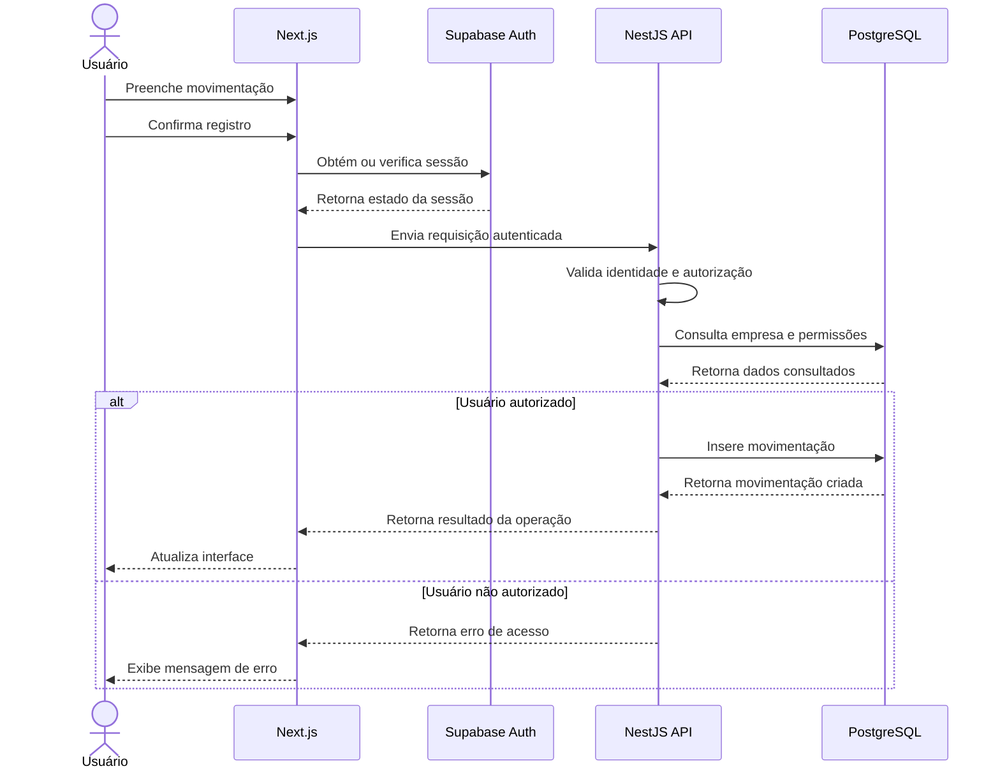
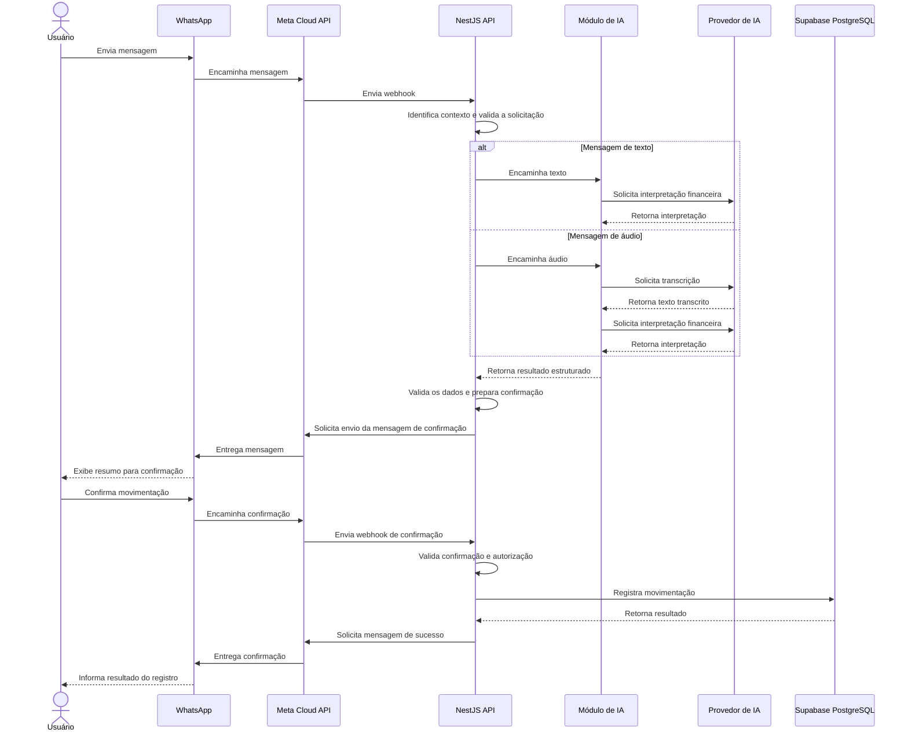
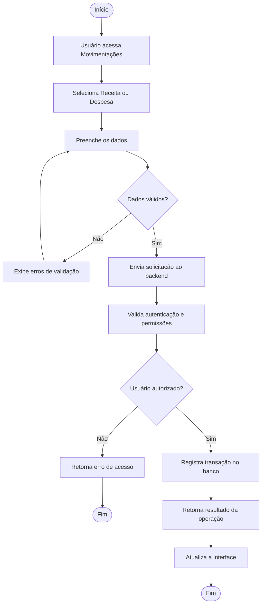
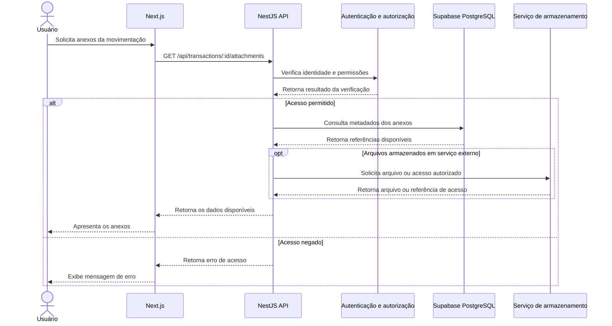

# 📐 Diagramas UML — MetricsFlow AI

Este documento reúne os diagramas UML do MetricsFlow AI, representando os principais atores, entidades e fluxos da aplicação.

Os diagramas devem ser mantidos alinhados ao código do frontend, backend e banco de dados. Funcionalidades ainda não implementadas são identificadas como planejadas.

---

# 👥 1. Diagrama de Caso de Uso

O diagrama apresenta as principais funcionalidades disponibilizadas aos usuários da plataforma.

---

# 📦 2. Diagrama de Classes

O diagrama representa as principais entidades do domínio financeiro e seus relacionamentos.

Os atributos abaixo refletem o modelo conceitual fornecido para a documentação. Antes de considerar o diagrama definitivo, é necessário conferir os campos com o esquema atual do banco de dados.

## 2.1. Descrição das classes

| Classe            | Responsabilidade                                                                              |
| ----------------- | --------------------------------------------------------------------------------------------- |
| `Profile`         | Representa os dados de perfil do usuário.                                                     |
| `Company`         | Representa uma empresa cadastrada na plataforma.                                              |
| `CompanyMember`   | Relaciona usuários às empresas e registra seus papéis.                                        |
| `Category`        | Representa categorias utilizadas na classificação financeira.                                 |
| `Transaction`     | Representa uma movimentação financeira, como receita ou despesa.                              |
| `Notification`    | Representa notificações associadas a usuários e empresas, caso o recurso esteja implementado. |
| `WhatsAppMessage` | Representa mensagens relacionadas ao fluxo de WhatsApp, caso exista persistência para elas.   |
| `Attachment`      | Representa os metadados ou a referência de um anexo associado a uma movimentação.             |

---

# 🔄 3. Diagrama de Sequência — Movimentação Web

Este diagrama representa o fluxo de criação de uma movimentação pela interface web, desde o preenchimento do formulário até a atualização da interface.

## 3.1. Etapas do fluxo

1. O usuário preenche os dados da movimentação.
2. O frontend obtém ou verifica a sessão de autenticação.
3. O frontend envia a requisição para a API.
4. O backend verifica a identidade e as permissões necessárias.
5. A API consulta os dados da empresa e a autorização do usuário.
6. Se a operação for autorizada, a API registra a movimentação no banco.
7. O backend retorna o resultado.
8. O frontend atualiza a interface.

---

# 🤖 4. Diagrama de Sequência — Fluxo Futuro do WhatsApp

> **Status: integração oficial planejada.** Este diagrama descreve um fluxo futuro e não deve ser interpretado como confirmação de que a integração com a WhatsApp Cloud API está ativa em produção.

O módulo de demonstração pode ser utilizado para testar partes do processamento sem que isso signifique que o recebimento de mensagens reais pelo WhatsApp esteja concluído.

---

# ⚙️ 5. Diagrama de Atividade — Registro de Movimentação

Este diagrama representa o processo de registro de uma movimentação pela plataforma web, incluindo a validação dos dados e a autorização da operação.

## 5.1. Descrição das etapas

| Etapa                      | Descrição                                                   |
| -------------------------- | ----------------------------------------------------------- |
| Início                     | O usuário inicia o processo de registro.                    |
| Seleção                    | Escolhe se a movimentação é uma receita ou uma despesa.     |
| Preenchimento              | Informa os dados necessários.                               |
| Validação dos dados        | Verifica se os campos atendem às regras de validação.       |
| Autenticação e autorização | O backend verifica a identidade e as permissões do usuário. |
| Registro                   | A API persiste a movimentação se a operação for autorizada. |
| Atualização                | O frontend apresenta o resultado ao usuário.                |
| Fim                        | O processo é concluído ou encerrado por erro de acesso.     |

---

# 📎 6. Diagrama de Sequência — Consulta de Anexos

Este diagrama representa a consulta de anexos associados a uma movimentação. O fluxo de acesso ao arquivo depende do serviço de armazenamento e das políticas efetivamente configuradas.

---

# 🧩 7. Relação entre os diagramas

Os diagramas representam perspectivas diferentes do mesmo sistema.

| Diagrama            | O que representa                                                        |
| ------------------- | ----------------------------------------------------------------------- |
| Caso de uso         | Os atores e as funcionalidades disponibilizadas.                        |
| Classes             | As entidades do domínio e seus relacionamentos.                         |
| Sequência web       | A interação entre frontend, autenticação, API e banco.                  |
| Sequência WhatsApp  | A integração oficial planejada para o processamento de mensagens.       |
| Atividade           | As etapas e decisões do processo de registro.                           |
| Sequência de anexos | A consulta aos metadados e, quando aplicável, aos arquivos armazenados. |
---
