# 🚀 Funcionalidades — MetricsFlow AI

A **MetricsFlow AI** é uma plataforma de gestão financeira desenvolvida para Microempreendedores Individuais (MEIs), com foco em simplificar o controle financeiro e oferecer uma visão clara da situação do negócio.

A aplicação utiliza um frontend desenvolvido com Next.js e React, um backend em NestJS e infraestrutura de autenticação e banco de dados fornecida pelo Supabase.

---

## 🎯 1. Objetivo

O objetivo da MetricsFlow AI é oferecer ao MEI uma ferramenta simples, visual e acessível para:

- Registrar receitas e despesas.
- Organizar movimentações por categorias.
- Consultar, pesquisar e filtrar o histórico financeiro.
- Editar e excluir transações.
- Visualizar indicadores de receitas, custos e despesas.
- Acompanhar o resultado financeiro.
- Analisar a evolução financeira por meio de gráficos.
- Consultar uma DRE simplificada.
- Gerenciar informações da empresa e seus membros.
- Gerenciar informações pessoais.
- Configurar preferências da aplicação.
- Controlar níveis de acesso de acordo com o papel do usuário.
- Consultar anexos associados às movimentações, caso o recurso esteja disponível.
- Utilizar funcionalidades de demonstração relacionadas ao processamento de mensagens.
- Preparar a plataforma para o registro financeiro por WhatsApp e a interpretação de mensagens com inteligência artificial.

---

## 📊 2. Dashboard

O dashboard apresenta uma visão geral da situação financeira da empresa atualmente selecionada.

Entre os indicadores e elementos previstos estão:

- Faturamento.
- Receitas.
- Despesas.
- Lucro ou resultado financeiro.
- Margem.
- Quantidade de movimentações.
- Evolução financeira.
- Gráficos e indicadores.
- Resumo financeiro.
- Transações recentes.
- Ações rápidas.

Os dados financeiros são relacionados à empresa selecionada e às movimentações disponíveis para o usuário.

A inclusão de novas movimentações pode refletir nos indicadores e gráficos conforme as consultas e os mecanismos de atualização implementados.

### 2.1. Fluxo de consulta

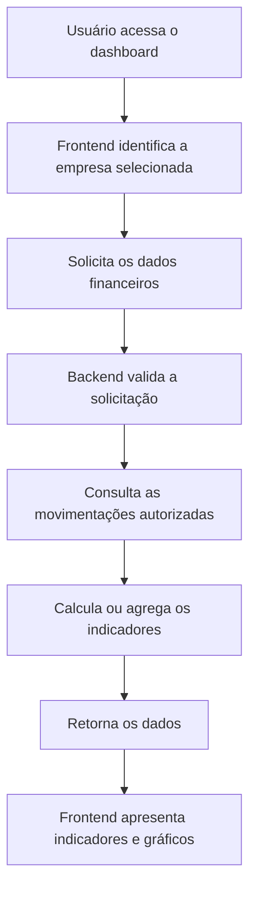

---

## 💰 3. Movimentações financeiras

A área de movimentações concentra o gerenciamento das entradas e saídas financeiras da empresa.

### 3.1. Receitas

O fluxo de registro de receita contempla os seguintes dados:

- Descrição.
- Valor.
- Categoria.
- Forma de pagamento.
- Data da movimentação.

### 3.2. Despesas

O registro de despesas utiliza uma estrutura semelhante à de receitas, diferenciando o tipo da movimentação.

Os dados devem ser validados antes da persistência, respeitando as regras de negócio e as permissões do usuário.

### 3.3. Histórico

O histórico pode apresentar as seguintes informações:

- Tipo.
- Descrição.
- Categoria.
- Forma de pagamento.
- Data.
- Valor.

Entre as funcionalidades da área estão:

- Busca por movimentações.
- Filtro por tipo.
- Filtro por categoria.
- Filtro por período.
- Edição.
- Exclusão.
- Exportação para CSV, se disponível na versão atual.
- Consulta de anexos associados à movimentação, caso implementada.

As movimentações possuem um campo de origem no modelo descrito pelo projeto. Esse campo pode permitir distinguir registros da plataforma web de registros provenientes de integrações, conforme as regras implementadas.

### 3.4. Fluxo de registro

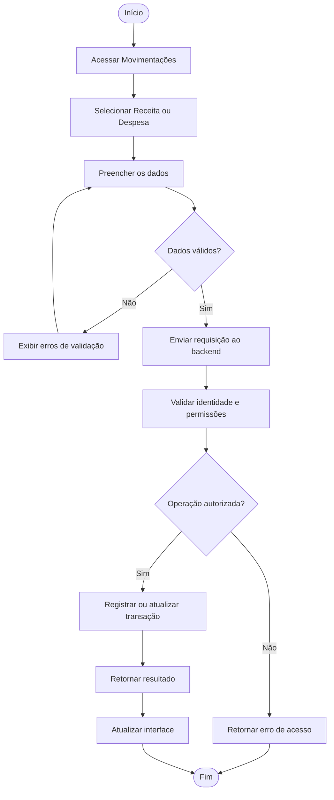

---

## 📎 4. Anexos das movimentações

A documentação contempla a possibilidade de associar anexos às movimentações financeiras.

Os anexos podem representar documentos ou arquivos relacionados a uma receita ou despesa, como comprovantes, desde que os tipos de arquivo correspondentes sejam aceitos pela implementação.

A estrutura pode envolver duas partes:

- **Banco de dados:** guarda os metadados e a referência do anexo.
- **Armazenamento de arquivos:** guarda o conteúdo do arquivo, caso exista um serviço de storage configurado.

### 4.1. Relacionamento conceitual

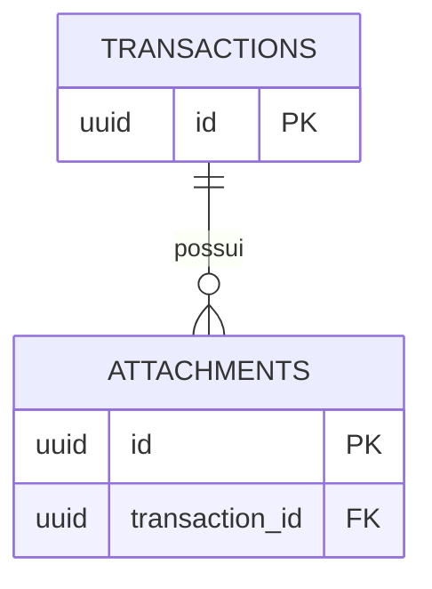

### 4.2. Fluxo conceitual de consulta

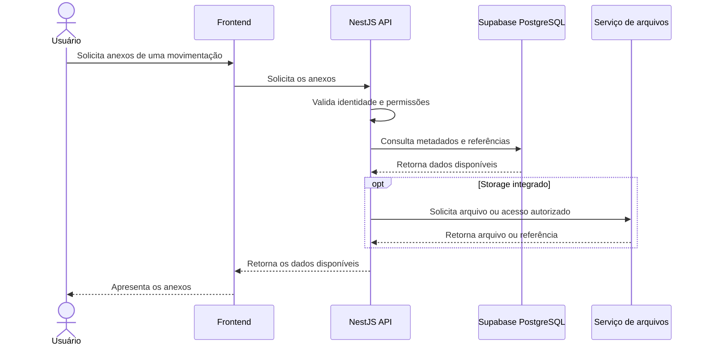

---

## 📈 5. DRE — Demonstração do Resultado do Exercício

A página de DRE apresenta uma visão consolidada do desempenho financeiro da empresa.

A estrutura funcional descrita para o projeto contempla:

- Receita.
- Custos.
- Despesas.
- Resultado.
- Margem.
- Distribuição por categorias.
- Comparação de indicadores.
- Gráficos.
- Seleção de período.
- Exportação para CSV.

A DRE utiliza movimentações financeiras para calcular indicadores referentes ao período selecionado, de acordo com as regras de classificação e cálculo implementadas.

### 5.1. Fluxo de consulta da DRE

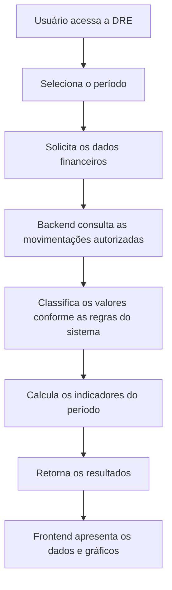

---

## 👤 6. Perfil

A área de perfil concentra as informações pessoais do usuário e os dados relacionados à sua conta.

A estrutura descrita contempla:

- Nome.
- E-mail.
- Telefone.
- Informações da conta.
- Informações relacionadas à segurança.

A autenticação e o gerenciamento de sessão são realizados pelo **Supabase Auth**.

Os dados do perfil da aplicação devem ser diferenciados dos dados internos de autenticação, conforme a estrutura efetiva do banco.

---

## 🏢 7. Empresa

A área de empresa concentra as informações relacionadas à organização e à equipe.

As funcionalidades descritas incluem:

- Consulta e gerenciamento de dados da empresa.
- Informações cadastrais.
- Consulta e gerenciamento de membros.
- Código de convite.
- Papéis de acesso.

O vínculo entre usuário e empresa é representado pela estrutura `company_members`, conforme o modelo de dados descrito para o projeto.

### 7.1. Proprietário

O papel `owner` representa o proprietário da empresa.

Pode ter permissões administrativas relacionadas à empresa e acesso às operações restritas conforme as regras de autorização implementadas.

### 7.2. Colaborador

O papel `collaborator` representa um membro da empresa que utiliza as funcionalidades disponibilizadas para sua participação.

Suas permissões podem ser diferentes das permissões administrativas do proprietário.

O nome do papel, isoladamente, não define todas as permissões: elas devem ser determinadas pelo backend e pelas políticas de acesso aplicáveis.

---

## ⚙️ 8. Preferências

A área de preferências concentra as configurações da experiência de utilização da plataforma.

As configurações descritas para o projeto incluem:

- Aparência.
- Preferências de notificações.
- Preferências financeiras.
- Período financeiro padrão.
- Moeda.
- Configurações relacionadas à conta.
- Área para ações sensíveis.

---

## 🔔 9. Notificações

O projeto prevê funcionalidades relacionadas a notificações financeiras e eventos da plataforma.

A estrutura descrita para esse recurso contempla:

- Identificação do usuário destinatário.
- Identificação da empresa relacionada.
- Identificação do usuário responsável pela ação.
- Tipo de notificação.
- Título e mensagem.
- Estado de leitura.
- Estado de arquivamento ou ocultação.
- Data de criação.

---

## 🔐 10. Autenticação

A MetricsFlow AI utiliza o **Supabase Auth** para autenticação e gerenciamento de sessões.

O fluxo descrito para a aplicação contempla:

- Login.
- Cadastro.
- Login com Google.
- Callback de autenticação.
- Recuperação e redefinição de senha.
- Persistência de sessão.
- Identificação do usuário autenticado.
- Identificação da empresa vinculada.
- Controle de acesso por papel.

### 10.1. Vínculo entre usuário e empresa

A relação conceitual entre autenticação, participação e empresa pode ser representada assim:

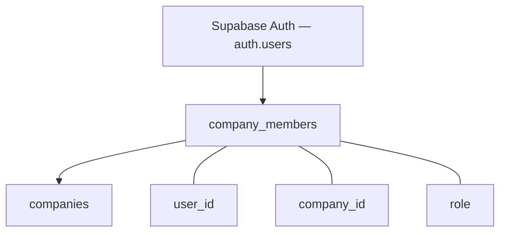

A tabela `auth.users` pertence ao schema de autenticação do Supabase. A tabela `company_members` representa a associação entre o usuário e a empresa, incluindo o papel atribuído.

---

## 👥 11. Controle de acesso

O acesso às funcionalidades é determinado pelo vínculo do usuário com a empresa e pelas permissões definidas na aplicação.

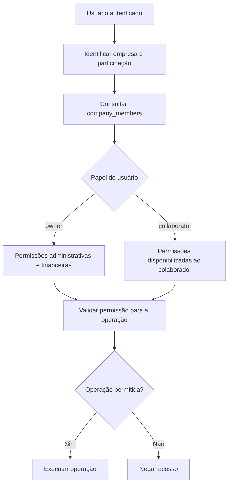

### 11.1. Proprietário

O papel `owner` pode ter acesso às seguintes áreas, conforme as regras implementadas:

- Dashboard.
- Movimentações.
- DRE.
- Perfil.
- Empresa.
- Membros.
- Preferências.
- Operações administrativas autorizadas.

### 11.2. Colaborador

O papel `collaborator` pode ter acesso às seguintes áreas, conforme as permissões configuradas:

- Dashboard.
- Movimentações.
- Perfil.
- Preferências.

Operações administrativas e ações restritas devem ser protegidas pelas verificações do backend e pelas políticas de acesso aplicáveis.

---

## 🧭 12. Onboarding

O onboarding organiza o fluxo de configuração inicial do usuário e da empresa.

O processo conceitual é:

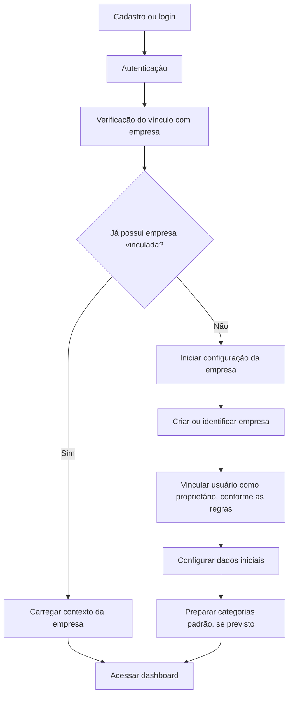

A criação da empresa, a associação do usuário como proprietário e a criação de categorias padrão devem obedecer às regras e operações efetivamente implementadas no banco e no backend.

---

## 📱 13. WhatsApp Demo

A V2 da MetricsFlow AI possui um **WhatsApp Demo**, acessível pela própria plataforma, para demonstrar o registro de movimentações financeiras por meio de mensagens de texto ou áudio.

O fluxo de demonstração permite enviar mensagens pela interface, interpretar informações financeiras com o módulo de IA, apresentar os dados para confirmação e registrar a movimentação confirmada na conta autenticada, conforme as validações e permissões da aplicação.

**Importante:** o WhatsApp Demo não é uma integração oficial com o WhatsApp. A **Meta Cloud API, o webhook oficial e o recebimento de mensagens reais pelo WhatsApp não estão implementados nesta etapa**.

### 13.1. Fluxo do WhatsApp Demo

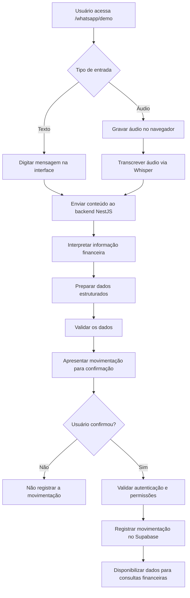

### 13.2. Escopo e limitações

- **Disponível:** demonstração de processamento de mensagens de texto na plataforma.
- **Disponível:** gravação de áudio no navegador e transcrição via Whisper no fluxo de demonstração.
- **Disponível:** interpretação de informações financeiras e apresentação para confirmação.
- **Disponível:** registro da movimentação após a confirmação, respeitando as validações e permissões implementadas.
- **Não implementado:** integração oficial com a Meta Cloud API.
- **Não implementado:** webhook para recebimento de mensagens reais do WhatsApp.
- **Não implementado:** processamento de mensagens recebidas diretamente de uma conta real do WhatsApp.

A conclusão do WhatsApp Demo representa a conclusão do fluxo de demonstração dentro da plataforma, **não a implantação de uma integração oficial com o WhatsApp**.

---

## 🤖 14. Inteligência artificial

A V2 utiliza um módulo de inteligência artificial para auxiliar na interpretação de informações financeiras fornecidas pelo usuário.

A interpretação pode identificar campos como:

- Tipo da movimentação.
- Valor.
- Descrição.
- Categoria sugerida.
- Forma de pagamento.
- Data.

A IA auxilia na interpretação dos dados fornecidos. A aplicação continua responsável pela validação dos campos, pela autorização e pelas regras de negócio antes da persistência.

### 14.1. Fluxo conceitual

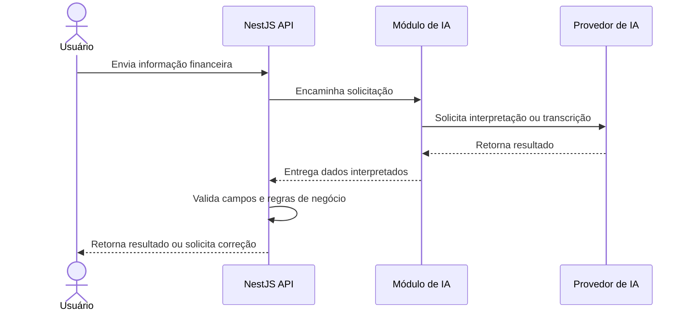

---

## 🔄 15. Fluxo geral da plataforma

O fluxo geral da aplicação conecta o usuário, o frontend, o backend e a persistência dos dados.

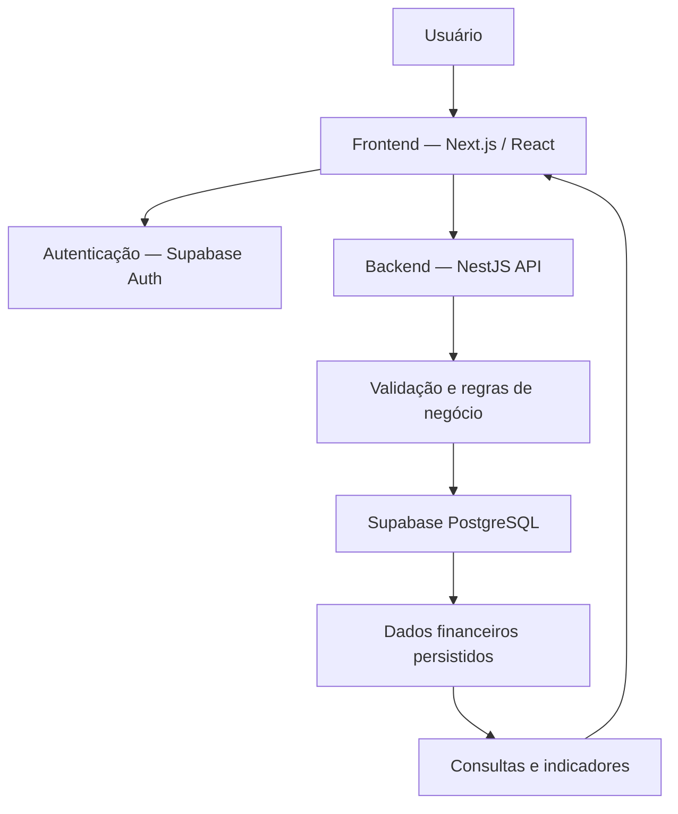

### 15.1. WhatsApp: demonstração atual e integração futura

O diagrama abaixo representa **uma possível integração futura com o WhatsApp oficial**. Ele não representa uma funcionalidade atualmente ativa na plataforma.

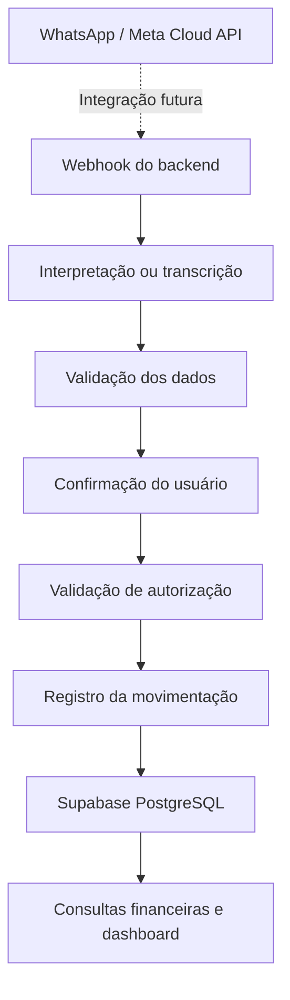

**Status:** o WhatsApp Demo funciona dentro da plataforma. A integração oficial com a Meta Cloud API permanece fora do escopo implementado e depende de desenvolvimento futuro.

---

## 🧰 16. Tecnologias e serviços

| Camada | Tecnologia ou serviço | Responsabilidade |
|---|---|---|
| Frontend | Next.js, React e TypeScript | Interface e interação com o usuário |
| Backend | NestJS e TypeScript | API REST, regras de negócio e autorização |
| Autenticação | Supabase Auth | Identidade e sessões |
| Banco de dados | PostgreSQL / Supabase | Persistência de dados relacionais |
| Inteligência artificial | Provedor configurado no backend | Interpretação financeira e transcrição, conforme integração |
| WhatsApp Demo | Interface de demonstração da plataforma | Simulação do fluxo de mensagens e registro financeiro |
| WhatsApp oficial | Meta Cloud API e webhook | **Integração futura, ainda não implementada** |
| Armazenamento de arquivos | Serviço a confirmar | Armazenamento de arquivos associados às movimentações, se integrado |

---

## 📌 17. Resumo das funcionalidades

| Área | Principais funcionalidades |
|---|---|
| Dashboard | Indicadores, gráficos, resumo financeiro e transações recentes |
| Movimentações | Receitas, despesas, busca, filtros, edição e exclusão |
| Anexos | Consulta de anexos associados às movimentações, se implementada |
| DRE | Receitas, custos, despesas, resultado, margem e gráficos |
| Perfil | Dados pessoais e informações da conta |
| Empresa | Dados cadastrais, membros, convite e papéis |
| Preferências | Aparência e configurações disponíveis |
| Notificações | Eventos e preferências, conforme a implementação |
| Autenticação | Login, cadastro, Google e recuperação de senha, conforme configurados |
| Controle de acesso | Papéis `owner` e `collaborator` |
| Onboarding | Configuração inicial e vínculo com a empresa |
| WhatsApp Demo | Demonstração de mensagens de texto e áudio dentro da plataforma |
| WhatsApp oficial | Integração com Meta Cloud API e recebimento de mensagens reais: **não implementados** |
| Inteligência artificial | Interpretação de informações financeiras e transcrição, conforme integração |
| Exportação | Exportação financeira para CSV, quando disponível |

---