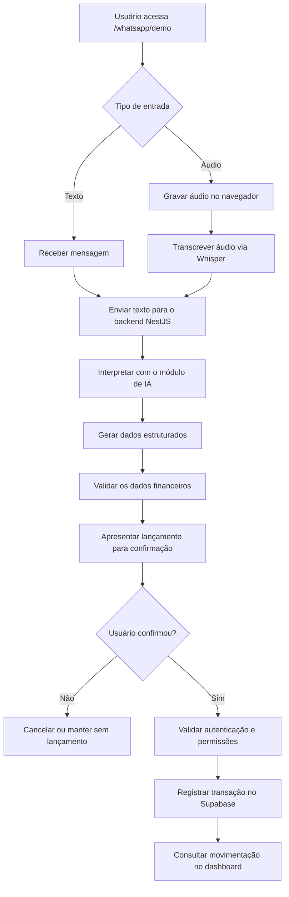

# 🚀 Status da V2

## Arquitetura

- [x] Estrutura monorepo
- [x] Separação `frontend/` e `backend/`
- [x] Frontend Next.js
- [x] Backend NestJS
- [x] API REST
- [x] Configuração de ambientes separados
- [x] CORS
- [x] Health check

## Backend

- [x] Estrutura NestJS
- [x] Supabase integrado
- [x] Autenticação via token
- [x] Guard de autenticação
- [x] Empresas
- [x] Membros
- [x] Categorias
- [x] Transações
- [x] CRUD de transações
- [x] Validação de permissões
- [x] Módulo de IA
- [x] Parser financeiro
- [x] Estrutura de transcrição
- [x] Estrutura inicial do módulo WhatsApp

## Inteligência Artificial

- [x] Serviço de interpretação financeira
- [x] Estrutura de tipos financeiros
- [x] Structured Output
- [x] Identificação de intenção
- [x] Identificação de tipo de movimentação
- [x] Identificação de valor
- [x] Identificação de descrição
- [x] Identificação de categoria
- [x] Identificação de forma de pagamento
- [x] Identificação de data
- [x] Validação da resposta estruturada
- [x] Transcrição de áudio via Whisper para a demonstração
- [x] Integração do fluxo de interpretação à demonstração
- [x] Confirmação antes do registro de lançamentos na demonstração

## WhatsApp Demo

- [x] Demonstração interativa sem conexão à Meta
- [x] Gravação de áudio no navegador
- [x] Transcrição de áudio via Whisper na demonstração
- [x] Interpretação da transcrição pelo parser financeiro
- [x] Fluxo de confirmação de lançamentos na demonstração

> **Observação:** `/whatsapp/demo` é uma simulação interativa. As mensagens são processadas e salvas na conta autenticada; os áudios são transcritos pelo Whisper; e os lançamentos só ocorrem após confirmação. Essa tela não utiliza nem valida a integração oficial da Meta.

---

# 🔮 Próxima etapa — Evolução do WhatsApp Demo

A próxima etapa do desenvolvimento é aprimorar o **WhatsApp Demo da MetricsFlow AI**, evoluindo o fluxo de demonstração de mensagens e áudios integrado ao backend NestJS e ao módulo de inteligência artificial já desenvolvido.

**O escopo desta etapa é exclusivamente a demonstração. Não será implementada a integração oficial com a Meta Cloud API, nem o recebimento de mensagens reais pelo WhatsApp.**

## Fluxo planejado

## Etapas de implementação

- [ ] Aprimorar a interface e a experiência do WhatsApp Demo.
- [ ] Refinar o envio e o processamento de mensagens de texto.
- [ ] Aprimorar a gravação e o processamento de áudios no navegador.
- [ ] Validar a transcrição de áudio via Whisper.
- [ ] Integrar e validar o fluxo de interpretação financeira pelo backend NestJS.
- [ ] Tratar mensagens que não contenham informações financeiras suficientes.
- [ ] Validar os dados retornados pelo parser financeiro.
- [ ] Aprimorar a apresentação dos dados antes da confirmação.
- [ ] Garantir que nenhum lançamento seja criado sem confirmação.
- [ ] Validar autenticação, empresa vinculada e permissões antes do registro.
- [ ] Tratar erros de transcrição, interpretação e persistência.
- [ ] Testar o fluxo completo de demonstração, do envio à consulta da transação.
- [ ] Documentar o funcionamento e as limitações do WhatsApp Demo.

## Escopo e limitações

O WhatsApp Demo continuará funcionando dentro da própria plataforma, por meio da rota `/whatsapp/demo`.

- **Entrada:** texto digitado ou áudio gravado no navegador.
- **Transcrição:** whisper, para a demonstração de áudio.
- **Interpretação:** módulo de IA e parser financeiro do backend.
- **Confirmação:** realizada na interface da demonstração.
- **Persistência:** transações confirmadas são registradas no Supabase, conforme as validações e permissões implementadas.
- **Integração com a Meta:** fora do escopo desta etapa.
- **Mensagens reais do WhatsApp:** não serão recebidas nem enviadas por uma integração oficial nesta fase.

O objetivo é consolidar e testar a experiência de automação financeira simulada antes de decidir sobre uma eventual integração com serviços externos.
